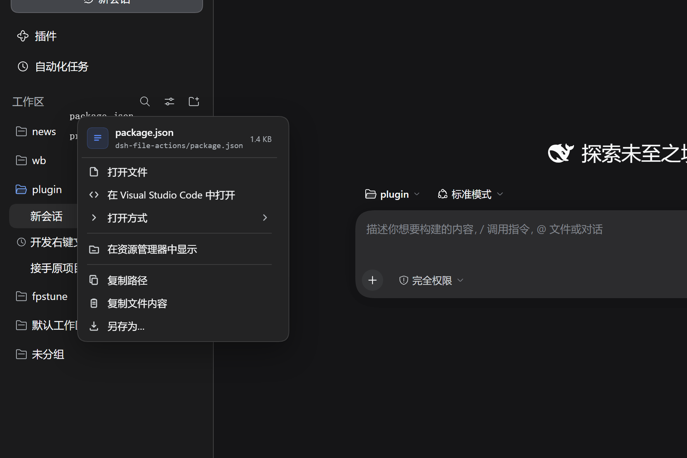
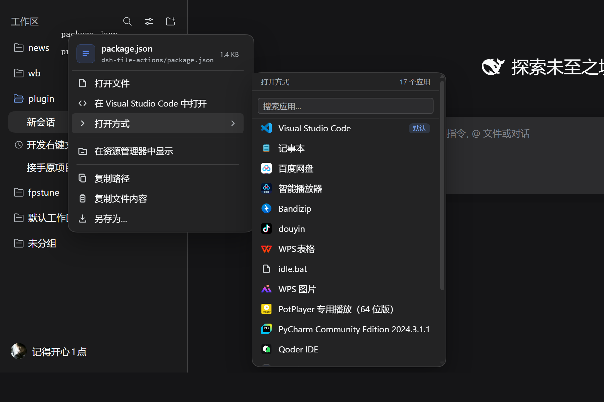
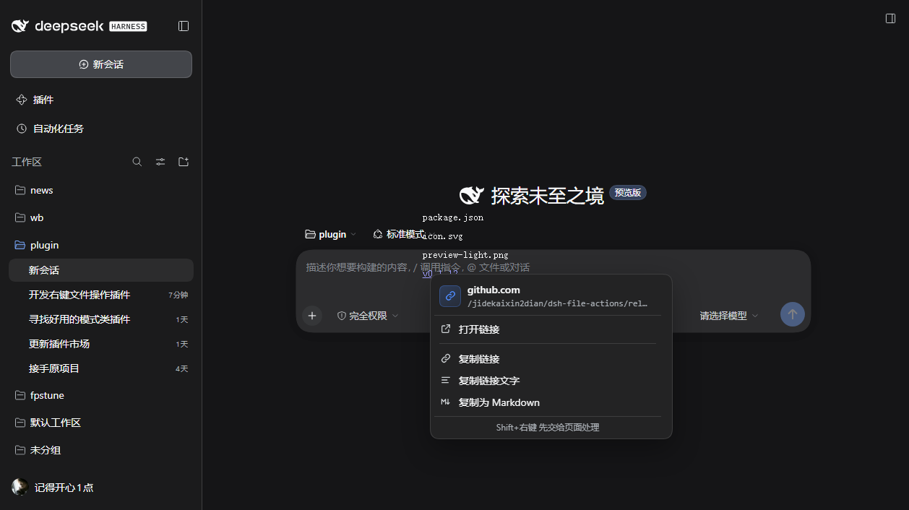
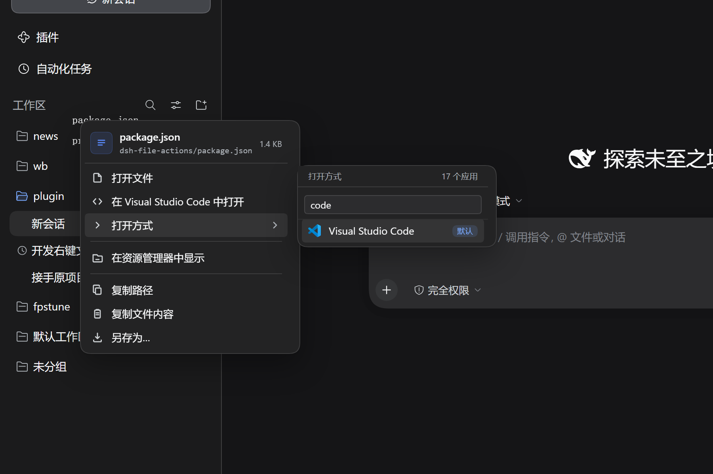
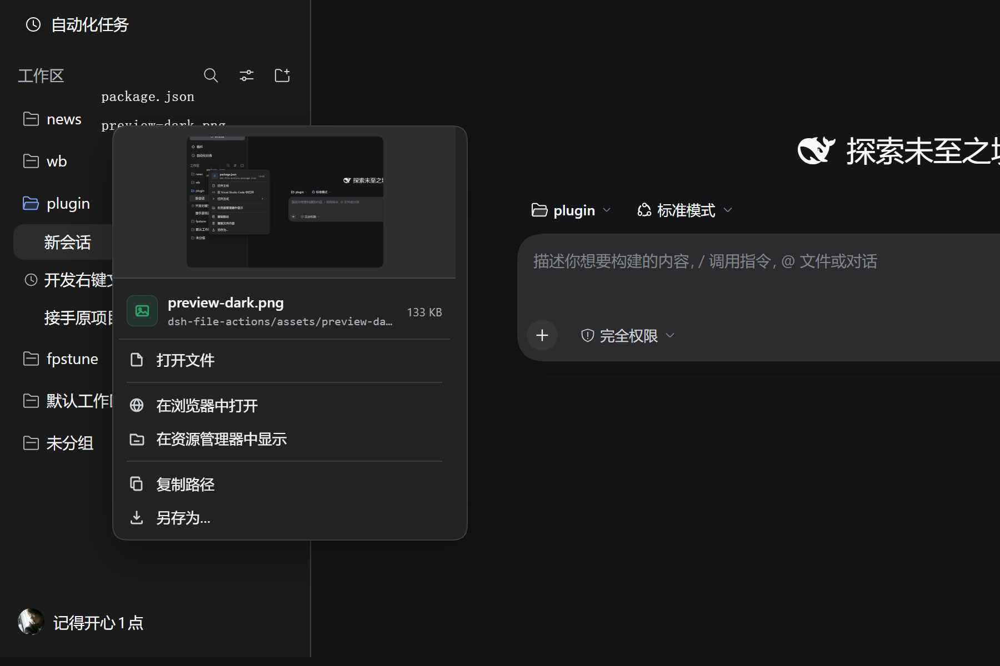
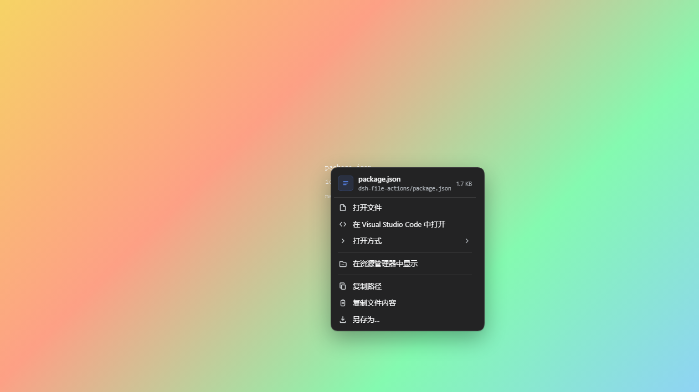
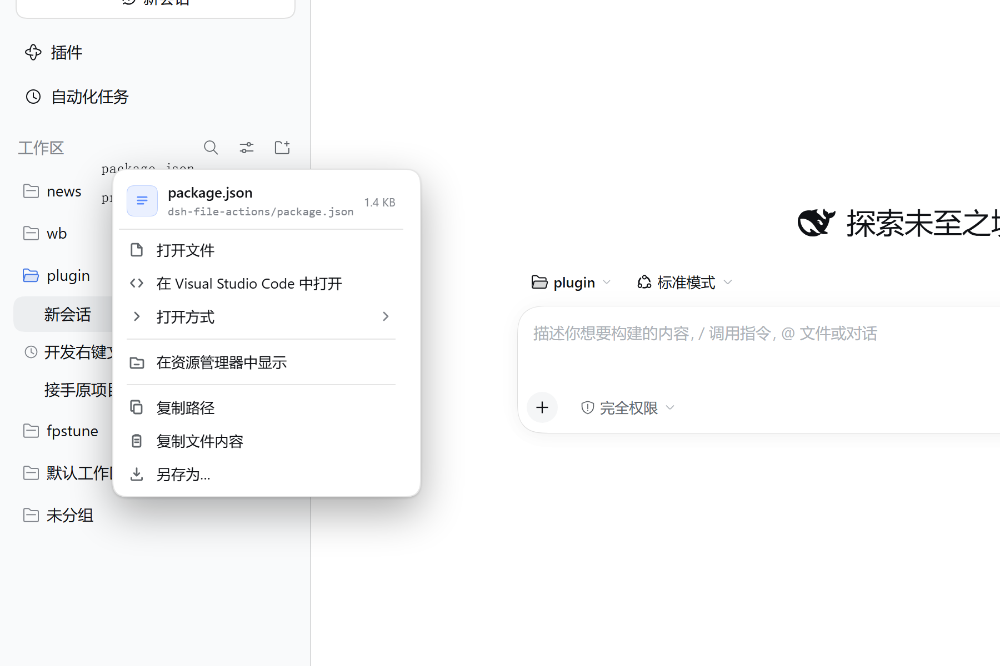

# dsh-file-actions

[中文](README.md)

**0.1.15** improves inline references, video previews and menu interaction, and fixes file-read integrity, preview isolation and application caches. npm and GitHub Release use the same verified archive, with npm provenance. See [npm](https://www.npmjs.com/package/@jidekaixin2dian/dsh-file-actions), [Releases](https://github.com/jidekaixin2dian/dsh-file-actions/releases/latest) and the [Changelog](CHANGELOG.md).

Right-click files and links to open, reveal, copy or save them.



## Install

Requires DSH `>=0.2.1-rc.2` (CI continuously verifies both 0.2.1-rc.2 and 0.2.1-rc.3) and Node >=24. Quit the DSH desktop app completely, then run:

```powershell
dsh plugin --profile desktop add @jidekaixin2dian/dsh-file-actions --registry=https://registry.npmjs.org
```

Reopen DSH to activate it. The explicit npm registry avoids mirror synchronization delays. Append `@0.1.11` to the package name to install that exact version.

GitHub Release installation remains available:

```powershell
dsh plugin --profile desktop add https://github.com/jidekaixin2dian/dsh-file-actions/releases/latest/download/dsh-file-actions.tgz
```

To download the npm archive without installing the plugin:

```powershell
npm pack @jidekaixin2dian/dsh-file-actions --registry=https://registry.npmjs.org
```

A plain `npm install` does not register the plugin with DSH; use `dsh plugin` above. To follow source instead, use `dsh plugin --profile desktop add github:jidekaixin2dian/dsh-file-actions`.

To remove it: dsh plugin --profile desktop remove @jidekaixin2dian/dsh-file-actions, then reopen DSH.

## Using it

Right-click a file name in any of these places:

- inline code in the transcript (blue, dotted underline)
- delivery cards and the changed-files list
- file links in tool-call rows (read, write, edit)
- the right Sidebar file tree
- the document preview title
- web links with the same blue style (GitHub releases, discussions, …)



The rows follow the file type:

| File | What you get |
|---|---|
| Code, text, config, subtitles | open, open in editor, open with, reveal, copy path, copy relative path, copy file name, copy contents, save as |
| Markdown, HTML, SVG, PDF, images | the same plus *Open in browser*; images and SVG also show a thumbnail |
| Video, audio | open, open with, play in browser (mp4 / mov / webm, mp3 / wav / flac …), save as |
| Office, archives, design files, 3D, disk images, binaries | open, open with, reveal, copy path, save as |
| Folders | open folder, reveal, copy path, copy relative path |
| Web links | open link, copy link, copy link text, copy as Markdown |

The link menu:



*Open with* keeps every registered application, ordered by preferred application, system default, editors, then other applications. A search box appears above seven entries.

Click the star beside an application to prefer it for that file type; click again to clear it. Keyboard users can press `Shift+Enter`. Preferences stay in this browser and do not change OS associations. Stored associations paint immediately and are validated in the background. An unavailable preference falls back to an available editor shortcut. Failed opens refresh associations without automatically repeating the action.

Explicit file references show progress and a retryable error when verification fails. Guessed text paths are verified on hover or focus; until verified, they retain the native menu. `Shift` lets the page handle a right-click first; if nobody handles it, the plugin falls back to its own menu.



Image files get a thumbnail:



Keyboard works too: `Shift+F10` or the menu key opens the same menu, `↑ ↓` move, `→` enters the submenu, `Enter` runs, `Esc` closes.

Readable on a wallpaper with a liquid-glass theme — the menu paints a near-opaque base under the themed layer:





## Limitations

- Not a native menu. Text follows the page root font size and page zoom, not the operating system text-size setting directly.
- *Open with* only lists registered applications. Preferences do not change OS defaults.
- Opening an editor currently opens the file only; the pinned Host API does not accept line or column positions.
- Save as uses the browser's download dialog with the original file name.
- Copy contents is capped at 2 MiB and accepts valid UTF-8 only. Other encodings require an editor. Copies outside the workspace require confirmation; unavailable confirmation cancels the read.
- Save as and browser previews read chunks up to 64 MiB total and stop if the file version changes. Larger files must be opened externally.
- HTML/SVG previews initially disable scripts, forms, automatic refresh and external resource loading. Trusted files can opt in to scripts and network access using the preview button. The opaque-origin sandbox still blocks access to DSH DOM/cookies. Relative sibling assets, top navigation and same-origin storage may not work. Clicking a link inside a file is an explicit user navigation.
- Web UI only — the terminal build has nothing to right-click.

## FAQ

**Why does the native menu appear?** Plain prose and editable fields keep it. Guessed file paths are verified on hover or focus; cold or failed guesses retain the native menu. Explicit file references show a reason and a retry action on failure.

**Is *Open with* unavailable?** Loading keeps placeholders; empty or failed results hide the association rows. Another right-click retries. Broken OS associations can fail the entire Host query; the plugin does not repair registry entries.

**Nothing opens in the browser?** The popup may have been blocked; allow popups and retry.

**How do I choose an application?** Click the star in *Open with*. Without a preference, the shortcut uses a recognised editor. *Open file* continues to use the system default.

## Development and verification

Node >=24, Git and pnpm:

```sh
npm ci --ignore-scripts
npm test
npm run setup:host
npm run test:host
npm run pack:check
```

The default pinned host is DSH **0.2.1-rc.3** (`1f81c047fc48fa190a683e469daa699857e9afe8`). Set `DFA_HOST_VERSION=rc.2` to verify the minimum supported host (`687f282e8625c6b8d11ff58211a90524be2e4317`). `DFA_HOST` can reuse the matching clean checkout. Windows uses headless Edge; Linux needs `npx --no-install playwright install --with-deps chromium`. CI covers rc.2/rc.3 on both systems. The plugin still has no runtime dependencies or build step.

The browser suite uses the actual client bundle and real WorkspaceFiles over synthetic references. It checks Session identity, sandboxed script isolation, a real 3 MiB download and unload behavior. A separate browser suite uses deterministic Remote responses for native-menu fallback, preferences, asynchronous stability, search and large text. This is not a complete Desktop or OS application-launch test. Optional full-Web drivers and historical assertion counts are documented in [test-e2e](test-e2e/README.md).

## Releases

- [Latest release](https://github.com/jidekaixin2dian/dsh-file-actions/releases/latest)
- [Announcement](https://github.com/deepseek-ai/deepseek-harness/discussions/10576)

## License

MIT
