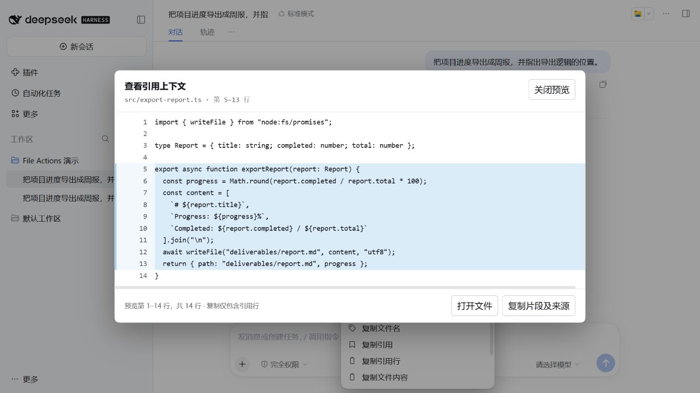
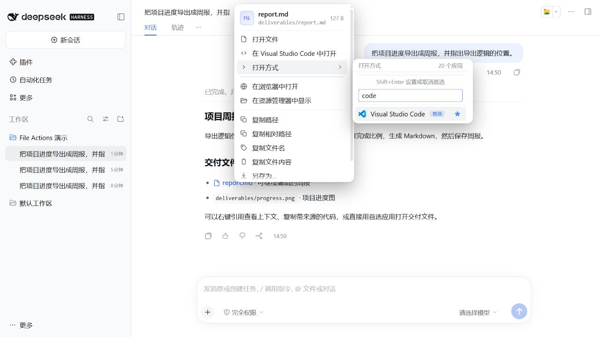
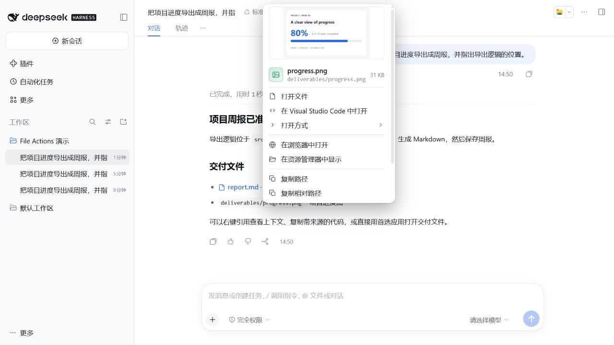
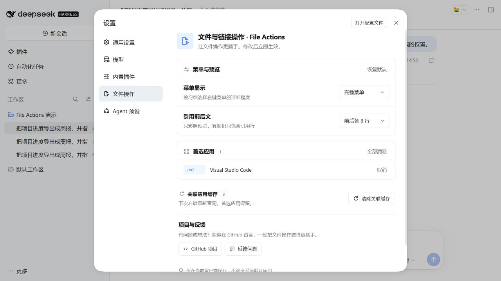

# File Actions · 文件与链接操作

**Copy code with its source. Keep working from delivered files.**

[中文](README.md) · [npm · 0.1.20](https://www.npmjs.com/package/@jidekaixin2dian/dsh-file-actions/v/0.1.20) · [Marketplace](https://awesome-dsh-plugin.com/p/jidekaixin2dian/dsh-file-actions/) · [Download](https://github.com/jidekaixin2dian/dsh-file-actions/releases/latest) · [Changelog](CHANGELOG.md)

File Actions adds file and link actions to DeepSeek Harness (DSH) conversations. Right-click a code reference, delivery card or image to continue from what the agent has shown you.

| Your next step | File Actions |
|---|---|
| Understand a code reference | Read surrounding lines with the referenced range highlighted |
| Share the exact excerpt | Copy code together with its source path and line range |
| Continue editing a delivered file | Search associated applications and save a preference per file type |
| Check an image or video | Preview a thumbnail, enlarge images or open a browser preview |

## Read the context, keep the source

Right-click a reference such as `src/app.ts:42:7` or `notes.md#L42-L48` to preview its context. Copy the excerpt with its source, or copy just the referenced lines.



## Keep working from delivered files

Open a file's conversation reference or changed-file card menu to choose an application, reveal the file, or copy its path, name or text. Save a preferred application for each file type.



## Preview images and videos

See available thumbnails in the menu, enlarge images, or open a browser preview. Video thumbnails use a frame decoded by the browser; you can also save a local copy.



## Adjust the menu to your workflow

Choose the full or compact menu, set the number of surrounding context lines, and manage application preferences. Open the menu with `Shift+F10`, then navigate with arrows and Enter.



## Install and update

Requires **DSH >=0.2.1-rc.2 and Node >=24**. CI verifies DSH rc.2 / rc.3 / rc.4 / rc.5 / 0.2.2-alpha.3 / 0.2.2-rc.1.

Search for **dsh-file-actions** in the marketplace and verify author **jidekaixin2dian**. Existing users can check updates under installed plugins. Catalog and registry mirrors may take time to refresh.

Alternatively, quit DSH completely and use the same command for installation or updates:

```powershell
dsh plugin --profile desktop add @jidekaixin2dian/dsh-file-actions --registry=https://registry.npmjs.org
```

Reopen DSH. Downloadable archives are available in [Releases](https://github.com/jidekaixin2dian/dsh-file-actions/releases/latest). A plain `npm install` does not register the plugin with DSH.

<details>
<summary>Alternative installation and removal</summary>

```powershell
dsh plugin --profile desktop add https://github.com/jidekaixin2dian/dsh-file-actions/releases/latest/download/dsh-file-actions.tgz
```

Remove, then reopen DSH:

```powershell
dsh plugin --profile desktop remove @jidekaixin2dian/dsh-file-actions
```

</details>

## Use

1. Right-click a file reference, delivery card or file tree. Explicit references open directly; guessed text paths are verified first.
2. Search **Open with** and star an application to remember it for that file type. OS defaults stay unchanged.
3. Enlarge image thumbnails or view supported documents, audio and video in the browser.
4. For text references such as `src/app.ts:42:7` or `notes.md#L42-L48`, choose **Copy referenced lines** to copy that line or range. Locations beyond the current file show an error instead of copying the whole file.
5. Choose **View reference context** for a read-only view with line numbers, highlighted referenced lines and nearby context. **Copy excerpt with source** includes the relative path, line range and referenced text, without the surrounding context. Preview display is bounded for long lines and large selections; copying retains the complete referenced lines. Reading outside the workspace requires confirmation before any content is read.

Referenced-line copying and context preview appear only when the reference retains its line numbers. If the host renders a link as a button exposing only its path, hidden line information cannot be recovered.

Keyboard: `Shift+F10` opens the menu, `↑ ↓` move, `→` enters a submenu, `Enter` runs and `Esc` closes. `Shift+right-click` gives the page's own handler priority.

The marketplace checks versions and installs after your click; it does not silently upgrade in the background. Restart DSH when requested.

## Settings

Open **File Actions** in the DSH settings sidebar (**文件操作** in Chinese); the page retains the full bilingual name:

- **Menu display**: full by default; compact mode keeps common open, reveal, reference preview, copy and save actions.
- **Reference context**: 4, 8 or 16 lines before and after, with 8 as the default. This does not change which referenced lines are copied.
- **Preferred applications**: view and remove individual preferences or clear them all. Set new preferences from a file's **Open with** menu.
- **Application cache**: clear after installing or removing applications. The next file menu queries again; preferences are retained.

Changes take effect immediately and persist in this browser or Desktop client. Resetting menu and preview defaults retains preferred applications. Preferences do not change system defaults or sync automatically to other clients.

Use **Project and feedback** at the bottom of settings to visit this plugin's GitHub repository or report an issue. Ideas and suggestions are welcome.

## Boundaries

- File operations use official DSH APIs and path authorization. Application lists depend on system associations; the plugin does not repair registry entries.
- Copying contents or referenced lines requires **valid UTF-8 and a file no larger than 2 MiB**. Referenced lines are copied in full, retaining internal line endings; column numbers do not trim the text. Copies outside the workspace require explicit confirmation; unavailable confirmation cancels the read.
- Save and browser previews read up to **64 MiB** and stop on inconsistent chunks. This is not an atomic filesystem snapshot.
- HTML / SVG previews block scripts and external resources by default. Enable scripts and networking only for a trusted file; the preview remains isolated from DSH. Relative assets may not work. Clicking a document link is an explicit navigation.
- Editor actions do not jump to line/column positions. Save uses browser download behavior. The plugin needs the graphical / Web UI.

<details>
<summary>FAQ</summary>

**Why the native menu?** Plain text, editable fields and unverified guessed paths retain it. Failed explicit references show a reason and retry action.

**Where is Open with?** Empty or failed queries hide those rows; right-click again to retry. Broken associations need a system or host fix.

**No preview window?** Check whether the browser blocked a popup.

</details>

## Downloads

| GitHub archives | npm | Combined |
|---:|---:|---:|
| [623](https://api.github.com/repos/jidekaixin2dian/dsh-file-actions/releases?per_page=100) | [2,255](https://api.npmjs.org/downloads/point/2026-10-23:2026-11-04/@jidekaixin2dian%2Fdsh-file-actions) | **2,878 requests** |

Snapshot: 2026-11-06; npm data through 2026-11-04. GitHub counts installation archives; npm excludes `0.0.0-stage`. Includes repeat installs and automation, not unique users.

[Development and verification](https://github.com/jidekaixin2dian/dsh-file-actions/blob/main/docs/development.md) · [Security](SECURITY.md) · [Issues](https://github.com/jidekaixin2dian/dsh-file-actions/issues)

MIT · Independent community plugin, not affiliated with DeepSeek.
