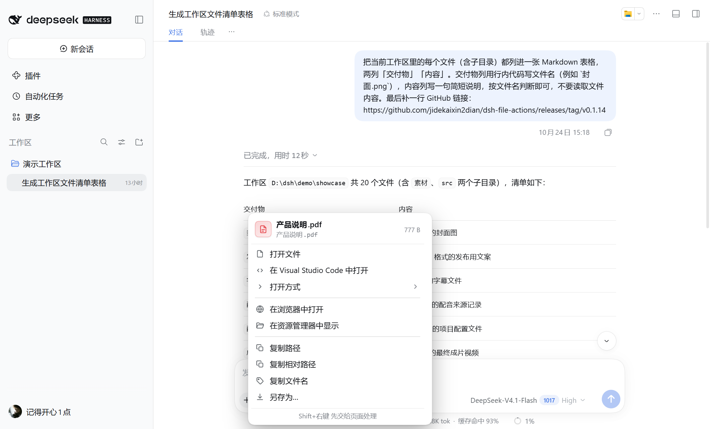
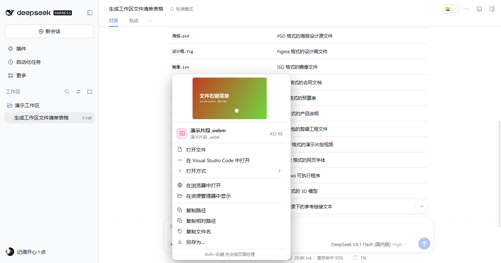

# 文件与链接操作 · File Actions

**在对话里右键 Agent 给出的文件，打开、预览或继续处理。**

[English](README.en.md) · [npm](https://www.npmjs.com/package/@jidekaixin2dian/dsh-file-actions/v/0.1.19) · [插件市场](https://awesome-dsh-plugin.com/p/jidekaixin2dian/dsh-file-actions/) · [下载](https://github.com/jidekaixin2dian/dsh-file-actions/releases/latest) · [更新记录](CHANGELOG.md)

File Actions 是 DeepSeek Harness（DSH）的文件和链接右键插件。Agent 在对话中给出文件后，直接右键文件引用或交付卡片，就能从插件菜单打开、定位、预览、复制或另存；也支持工具结果及提供文件路径的侧栏。


## 从文件引用接着做

| 想做什么 | 可以怎么做 |
|---|---|
| 接着编辑文件 | 用默认应用打开，或搜索「打开方式」并收藏首选应用 |
| 找到文件与引用 | 在文件管理器定位，复制绝对 / 相对路径、文件名或带行号引用 |
| 查看与带走内容 | 预览支持的文档、图片或媒体；复制文本；另存为本地文件 |
| 分享链接 | 打开网页，复制链接、链接文字或 Markdown |

## 图片、视频与文件引用

- **图片预览**：右键图片引用，菜单内显示可用的缩略图；点击缩略图可以放大查看，不必先切换到图片应用。缩略图读取上限为 8 MiB。
- **视频预览**：右键视频引用，可在菜单中查看从视频提取的画面缩略图；支持的格式还能通过「在浏览器中打开」播放完整视频。缩略图依赖浏览器解码，文件超过 8 MiB 或无法解码时不会显示；浏览器预览及另存上限为 64 MiB。
- **交付文件接着编辑**：从当前对话的文件引用进入「打开方式」，搜索系统关联的应用并按文件类型收藏首选，不修改系统默认应用。
- **代码引用上下文**：保留行号的引用可只读查看引用行及前后文，也可复制引用片段和来源路径；宿主未暴露行号时无法使用这些操作。





图片来自此前的隔离演示环境；界面会随版本变化。

## 下载情况

| GitHub Release 资源 · 历史累计 | npm 0.1.17 · 近 7 日 |
|---|---|
| [**350 次下载**](https://api.github.com/repos/jidekaixin2dian/dsh-file-actions/releases?per_page=100) | [**191 次下载**](https://api.npmjs.org/versions/@jidekaixin2dian%2Fdsh-file-actions/last-week) |

统计快照：**2026-10-29**。GitHub 包含安装包、校验文件等资源请求；npm 仅统计表中版本。下载可能包含重复安装和自动化请求，不代表独立用户数，两列不相加。点击数字可查看实时来源。

## 安装与更新

需要 **DSH >=0.2.1-rc.2、Node >=24**；持续验证 DSH rc.2 / rc.3 / rc.4 / rc.5。

在插件市场搜索 **dsh-file-actions**，确认作者为 **jidekaixin2dian** 后安装；已有用户在「已安装」中检查更新。市场数据与 npm 镜像可能有同步延迟。

也可完全退出 DSH 后，使用同一条 CLI 命令安装或更新：

```powershell
dsh plugin --profile desktop add @jidekaixin2dian/dsh-file-actions --registry=https://registry.npmjs.org
```

重新打开 DSH 生效。离线包可从 [Release](https://github.com/jidekaixin2dian/dsh-file-actions/releases/latest) 下载；普通 `npm install` 不会把插件注册进 DSH。

<details>
<summary>其他安装方式与卸载</summary>

GitHub Release 安装：

```powershell
dsh plugin --profile desktop add https://github.com/jidekaixin2dian/dsh-file-actions/releases/latest/download/dsh-file-actions.tgz
```

卸载后重新打开 DSH：

```powershell
dsh plugin --profile desktop remove @jidekaixin2dian/dsh-file-actions
```

</details>

## 用起来

1. 在聊天文件名、文件卡片或文件树上右键。明确引用可直接操作，普通文字里的疑似路径会先验证。
2. 选择「打开方式」可搜索应用，点击星标保存当前文件类型的首选；不会改变系统默认应用。
3. 图片支持缩略图与放大预览；支持的文档、音视频可在浏览器中查看。
4. 对 `src/app.ts:42:7` 或 `notes.md#L42-L48` 这类文本引用，可选「复制引用行」复制该行或该段，不必复制整个文件。行号超出当前文件范围时会提示，不会改为复制全文。
5. 选择「查看引用上下文」，在只读预览中查看行号、高亮引用行及少量前后文；「复制片段及来源」一次带走相对路径、行号与引用正文，不包含额外上下文。长行或较大引用会在预览中缩短显示，复制保留完整引用行。

引用行复制和上下文预览仅在引用仍保留行号时出现；宿主若把链接渲染为仅暴露路径的按钮，插件无法恢复已隐藏的行号。

键盘：`Shift+F10` 打开菜单，`↑ ↓` 移动，`→` 进入子菜单，`Enter` 执行，`Esc` 关闭。`Shift+右键` 优先交给页面原有菜单。

更新由市场检查并在你点击后安装，不会静默后台升级；需要时按提示重启 DSH。

## 设置

在 DSH 设置侧栏打开 **文件操作**（英文界面为 **File Actions**）；页面保留完整中英文名称：

- **菜单显示**：默认完整菜单；精简模式保留常用打开、定位、引用预览、复制和另存操作。
- **引用前后文**：前后各 4 / 8 / 16 行，默认各 8 行；不改变引用正文的复制范围。
- **首选应用**：查看已设置的文件类型，单独取消或全部清除；选择新首选仍在文件的「打开方式」菜单中完成。
- **关联应用缓存**：安装或卸载应用后可清除缓存，下次右键重新查询；保留首选应用。

修改立即生效，并保留在当前浏览器或 Desktop 客户端。恢复菜单与预览默认设置不会清除首选应用；这些偏好不会修改系统默认应用，也不会自动同步到其他客户端。

页尾的「项目与反馈」可打开本插件的 GitHub 项目或新建反馈；欢迎提出问题和改进想法。

## 使用边界

- 打开与定位沿用 DSH 官方接口和路径授权；应用列表取决于系统关联。失效关联可能导致列表不可用，插件不会修改注册表。
- 复制内容与引用行仅支持 **有效 UTF-8、文件最大 2 MiB**。引用行按整行复制，保留所选行之间的原始换行；列号不裁剪内容。工作区外复制或引用上下文预览需要先明确确认；确认不可用时取消读取。
- 另存为和浏览器预览最多读取 **64 MiB**，分块内容不一致时中止；不是文件系统原子快照。
- HTML / SVG 默认静态预览并阻止脚本和外部资源。仅在信任文件后启用脚本与联网；预览仍与 DSH 页面隔离。相对资源可能不可用，点击文件内链接属于主动导航。
- 编辑器打开暂不跳到行列位置；另存为使用浏览器下载行为。插件用于 DSH 图形 / Web 界面，终端界面不适用。

<details>
<summary>常见问题</summary>

**为什么还是原生右键菜单？** 普通文字、输入框，以及尚未验证的疑似路径保留原生菜单。明确引用验证失败时会显示原因与重试入口。

**找不到「打开方式」？** 查询为空或失败时会隐藏关联行，下次右键重试。系统损坏的应用关联需要在系统或宿主侧处理。

**预览没有打开？** 检查浏览器是否拦截了弹窗。

</details>

[开发与验证](https://github.com/jidekaixin2dian/dsh-file-actions/blob/main/docs/development.md) · [安全说明](SECURITY.md) · [反馈问题](https://github.com/jidekaixin2dian/dsh-file-actions/issues)

MIT · 独立社区插件，与 DeepSeek 官方无隶属关系。
