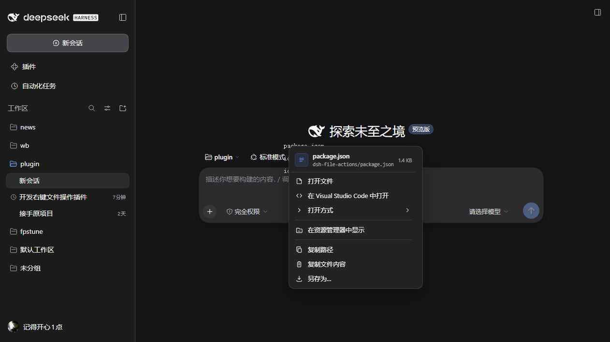
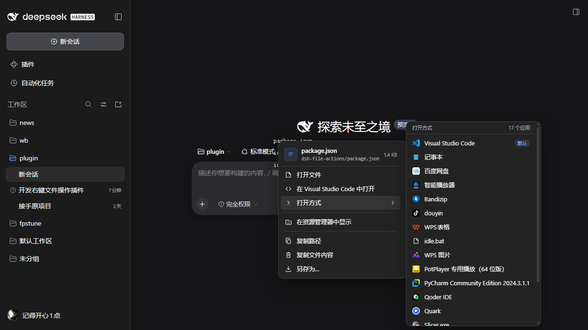
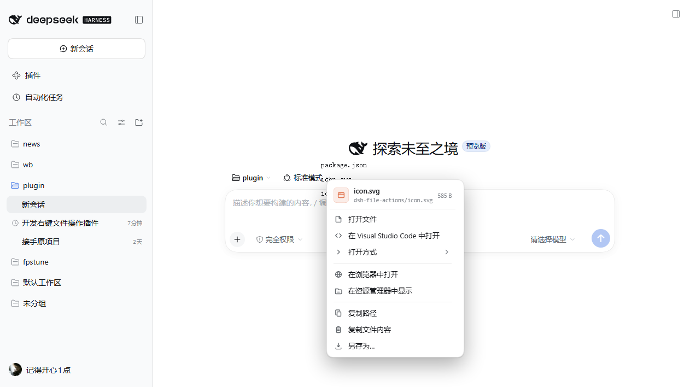

# dsh-file-actions

给 DeepSeek Harness（DSH）桌面端/网页端的**文件右键菜单**：在聊天里右键任意蓝色文件名，直接打开、打开方式、在资源管理器中显示、复制路径、复制文件内容、另存为。

对齐 OpenAI Codex 桌面端的文件引用菜单。Codex 的 UI 是闭源的（官方开源清单把 IDE 扩展标为 *Not open source*，桌面端甚至不在清单里），所以本插件按可观测行为与公开 issue 还原功能，而不是移植代码。





## 功能

右键一个文件引用（行内 code、交付卡片、改动文件行、工具调用行、右侧文件树、文档预览头），弹出：

| 菜单项 | 行为 | 说明 |
|---|---|---|
| 打开文件 / 打开文件夹 | 用系统默认应用打开 | 走 DSH 自带的 `session.openWorkspacePath` |
| 在 VS Code 中打开 | 用检测到的编辑器打开 | 自动识别 VS Code / Cursor / Windsurf / Zed / JetBrains 等 |
| 打开方式 ▸ | 子菜单列出系统关联应用 | 带真实应用图标与「默认」勾选 |
| 在浏览器中打开 | HTML / SVG / PDF / 图片 / Markdown | 以 Blob 打开，不写临时文件 |
| 在资源管理器中显示 | 定位并选中文件 | 目录则为「在资源管理器中打开」 |
| 复制路径 | 绝对路径进剪贴板 | |
| 复制相对路径 | 相对会话工作区的路径 | 显示路径已是绝对路径时不出现 |
| 复制文件内容 | 文本进剪贴板 | 二进制、>2 MB 会提示改用「另存为」 |
| 另存为… | 浏览器下载对话框 | 不经过磁盘中转 |

按文件类型收敛菜单：图片/PDF 没有「复制文件内容」，Office/压缩包/二进制只有外部动作，目录没有「另存为」。

菜单头部是一块文件身份区：按类型着色的字形块、文件名、工作区相对路径，右侧是大小；工作区外的文件显示绝对路径并标「工作区外」。系统关联查询慢时菜单先出现，编辑器与「打开方式」行随后补入；子菜单有吸顶的计数标题，列表可滚动。

键盘：`Shift+F10` 或菜单键在焦点元素上打开同一菜单；`↑ ↓ Home End` 移动，`→` 展开子菜单，`←` 收起，`Enter` 执行，`Esc` 关闭。键盘打开时菜单底部会显示这三条提示。



## 安装

```powershell
# 先完全退出 DSH 桌面端，再安装并重开
dsh plugin --profile desktop add @jidekaixin2dian/dsh-file-actions
```

本地源码开发：

```powershell
pwsh -File .\scripts\reinstall.ps1 -Profile desktop   # 退出桌面端后运行
pwsh -File .\scripts\reinstall.ps1 -CheckOnly         # 只看会执行什么
```

## 为什么不需要宿主半

打开、打开方式、资源管理器都复用 DSH 已发布的 Session Remote：

- `session.openWorkspacePath({ path })` / `{ path, application }` / `{ path, action: 'reveal' }`
- `session.workspacePathApplications({ path })` → 系统关联应用（含 data-URI 图标与默认标记）

读取内容与另存为复用 `workspaceFiles.readBytes(sessionId, path, {})`。

这些路由都要求路径能被组合文件系统映射到同一个进程路径，未映射的远端路径在启动原生命令前就被拒绝——插件不自己拼命令行，也不放宽任何授权。宿主半因此是空实现，只用来挂载 bundle 行。

## 识别策略

文件引用在 DSH 的 DOM 里有多种形态，按可靠性依次尝试：

1. **结构化载体**：`data-files-path`（文件树，值本身是混用分隔符的绝对路径）、`data-review-file`（Review 标签页）、`[data-presented-file]` 内 `[title]`（交付卡片）、任意祖先的 `title`（行内 code 链接与文档预览头写的是完整路径）。
2. **链接**：`file://` 或纯路径 `href`。
3. **元素自身文本**：工具行 `button[class*="fileLink"]` 只有相对路径文本、没有 title。
4. **光标处 token**：`caretRangeFromPoint` 兜底，用于行内 code。

所有候选都要先通过 `workspaceFiles.stat`（文件）或 `list`（目录）验证才会弹菜单。右键按下时原生菜单就已被接管，所以验证失败时不会出现任何菜单——因此纯文本猜测额外要求「像真实文件」（绝对路径或带扩展名），避免把 `2026/10/22 12:00`、`2/3 files` 这类普通文本的右键菜单吞掉；结构化载体（data 属性、交付卡片、`file:` 链接）验证失败时会提示「找不到该文件」。可编辑区域（输入框、`contenteditable`）和真正的网页链接保持 Chromium 自带菜单。

菜单**立即出现**，系统关联应用（Windows 上要查 Shell 关联，冷启动 2–4 秒）异步补进去并按扩展名缓存。

## 与 Codex 的差异

| 项 | Codex | 本插件 |
|---|---|---|
| 菜单渲染 | 原生 OS 菜单（`打开方式` 的图标会丢） | HTML 渲染，跟随 DSH 主题，关联应用带真实图标 |
| 「在 X 中打开」 | 按扩展名门控 | 按系统关联自动选编辑器，其余进「打开方式」 |
| 复制路径 | 有（Windows 曾有前导 `/` 的 bug） | 有，写绝对路径 |
| 另存为 | 有（实现未公开） | 浏览器下载对话框，文件名取原文件名 |
| 打开方式 | 原生子菜单 | HTML 子菜单，可滚动，勾选默认应用 |
| 内部预览 | 默认点击打开预览标签页 | 点击行为保持 DSH 原样，右键只加动作 |

## 已知限制

- **不是原生菜单**：不跟随系统菜单的字体缩放与动画。
- **打开方式列表来自系统文件关联**，不是 DSH 的应用目录；未注册关联的程序不会出现。查询失败或返回空时不会缓存，下次右键会重试。
- **另存为走浏览器下载**，不提供「另存到指定目录」的原生对话框。
- **内容复制上限 2 MB**，更大的文件请用「另存为」；超过上限的文件不会跨线传输（先用 stat 的字节数判断）。
- **「二进制」的判定是「UTF-8 解码后含 NUL」**：UTF-16 文本会被判成二进制而拿不到「复制文件内容」，不含 NUL 的二进制则可能被当文本复制。
- **读取走 Host 的 `workspaceFiles`，允许会话工作区之外的路径**（DSH 本身如此）。菜单头会标「工作区外」，但不会阻止读取——路径就明写在菜单上。
- **仅 Web 面**：DSH 的 TUI/CLI 没有可右键的 DOM。

## 验证

- 单测：`node --test`，30 个，覆盖路径解析、动作参数、工作区内外判定、相对路径与头部字段、类型分类、菜单生成、Remote 信封。
- 组合层：`dsh --profile dfa-check --dump-config` 能看到 `id: dsh-file-actions`；首页 boot graph 含 `@jidekaixin2dian/dsh-file-actions/client.js`。
- 真机：`test-e2e/` 用 scratch profile + headless Chromium/CDP，30 项断言全过（激活、就绪、四种载体、类型分类、异步关联行、焦点进入菜单、滚动不关闭、右键菜单自身不叠加、键盘走行与 Enter 执行、子菜单键盘可达、无效路径不弹菜单）。
- 真机端到端（`test-e2e/verify.mjs`，真鼠标右键右侧文件树行）：**9 PASS / 0 FAIL** —— 菜单出现且为 7 项、点「复制路径」后剪贴板拿到绝对路径 `D:\dsh\plugin\_scratch\asar.mjs`、toast「路径已复制」。
- 真实 DOM 依据：`test-e2e/ground-truth.json`（真机 CDP + 真鼠标右键采集的载体与祖先链），完整报告见 `test-e2e/REPORT.md`。

```powershell
cd test-e2e
pwsh -File .\start-instance.ps1   # 建 dfa-check profile、装插件、起 5499
node .\self-check.mjs             # 30/30
pwsh -File .\start-instance.ps1 -Stop
```

## 插件市场

已提交到 dsh-market 的插件目录（[awesome-dsh-plugin PR #8534](https://github.com/awesome-dsh-plugin/awesome-dsh-plugin/pull/8534)），条目文件在 [`submission/`](submission/)。

- 仓库与 Release：https://github.com/jidekaixin2dian/dsh-file-actions/releases/latest
- 条目里的 `tarball` 指向 `releases/latest/download/dsh-file-actions.tgz`（版本无关，换版本不失效），也就是市场一键安装实际下载的地址；已用 `pnpm add <该 URL>` 在干净 profile 里实测装得上。
- 门禁要求仓库创建满 1 天：仓库建于 2026-10-21T17:17Z，2026-10-22T17:17Z 之后 CI 自动转绿（`regate.yml` 每 6 小时重跑）。

## License

MIT
